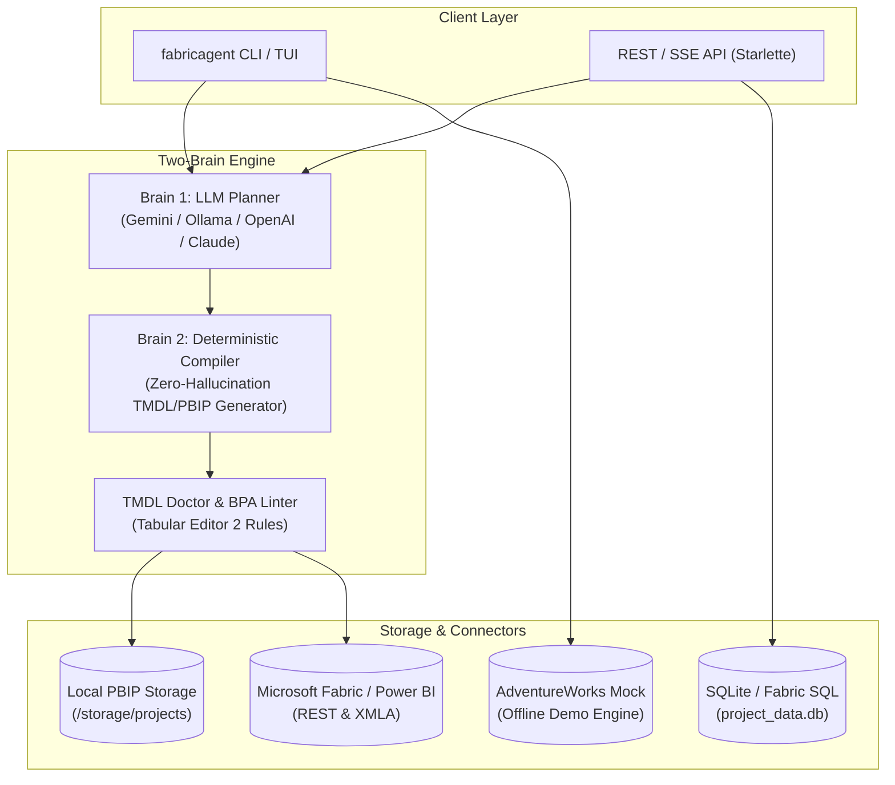

# FabricAgent

<div align="center">

[](https://www.python.org/downloads/)
[](https://opensource.org/licenses/MIT)
[]()
[](https://github.com/psf/black)
[]()
[]()

**Autonomous Open-Source AI Agent & Terminal Platform for Microsoft Power BI & Microsoft Fabric**

*Transform business requirements, data warehouse schemas, and local files into production-grade Power BI models (TMDL/PBIP) and PBIR reports — powered by multi-provider LLM intelligence and deterministically validated by Tabular Editor BPA and TMDL Doctor.*

[Key Features](#-key-features) •
[Quick Start](#-quick-start) •
[Terminal Assistant (TUI)](#-terminal-assistant-tui) •
[$0 Budget / Free Tiers](#-free--0-budget-options) •
[CLI Reference](#-cli-command-reference) •
[Architecture](#-architecture) •
[Configuration](#-configuration-reference)

</div>

---

## 💡 Why FabricAgent?

Authoring enterprise Power BI semantic models and Fabric data warehouses is often repetitive, tedious, and error-prone:
- Calculating complex DAX measures requires constant guarding against divide-by-zero, filter context bugs, and relationship ambiguity.
- Standard LLMs (ChatGPT, Claude) produce convincing-looking DAX code that frequently uses non-existent functions or hallucinates columns that don't exist in your warehouse schema.
- Synchronizing star schemas between data warehouses (Fabric Lakehouse / Warehouse / SQL Server) and TMDL/PBIP definitions requires tedious manual mapping in Power BI Desktop.

**FabricAgent** solves this with a **Two-Brain Architecture**:
1. **Brain 1 (AI Strategy / Planner)**: Uses LLMs (Google Gemini, local Ollama, OpenAI, Claude, or Groq) to analyze business requirements, identify dimensions vs. facts, and suggest optimal star schemas and DAX calculations.
2. **Brain 2 (Zero-Hallucination Compiler & Guardrail Gate)**: 100% deterministic code compilation that enforces schema integrity, auto-repairs relationship directions, lints against 60+ Tabular Editor Best Practice Analyzer (BPA) rules, and outputs clean, valid TMDL and PBIP files.

---

## ⚡ Quick Start

### 1. One-Liner Automated Install

#### Linux & macOS
Run the automated installer in your terminal:
```bash
./install.sh
```
*Or install directly via curl:*
```bash
curl -fsSL https://raw.githubusercontent.com/Amrit-D-V/FabricAgent/main/install.sh | bash
```

#### Windows (PowerShell or Command Prompt)
```cmd
install.bat
```

The installer automatically:
- Checks for Python 3.11+ (supports 3.11, 3.12, 3.13, 3.14)
- Provisions an isolated `.venv` virtual environment
- Installs all dependencies and registers the `fabricagent` CLI
- Generates secure cryptographic secret keys (`.app_secret_key`)
- Launches the interactive setup wizard (`fabricagent setup`)

---

### 2. Manual Installation

If you prefer to configure the environment manually:

```bash
# Clone repository
git clone https://github.com/Amrit-D-V/FabricAgent.git
cd FabricAgent

# Create and activate virtual environment
python3 -m venv .venv
source .venv/bin/activate  # Windows: .venv\Scripts\activate

# Install dependencies and local CLI package
pip install -r requirements.txt
pip install -e . --no-deps

# Run the setup wizard
fabricagent setup
```

---

## 🖥️ Terminal Assistant (TUI)

Launch the interactive, colorized terminal assistant:

```bash
fabricagent tui
```

```text
╭──────────────────────────────────────────────────────────────────────────────╮
│ FabricAgent Terminal Assistant v0.2.0                                        │
│ Engine: gemini • Model: gemini-flash-latest • Mode: dashboard                │
│                                                                              │
│ Ask about DAX, Power BI models, star schemas, or type /help for commands.    │
╰──────────────────────────────────────────────────────────────────────────────╯

fabricagent> Write a safe YoY Sales Growth measure for FactInternetSales

────────────────────────────────────────────────────────────────────────────────
YoY Sales Growth % = 
VAR _CurrentYearSales = [Total Sales]
VAR _PriorYearSales = 
    CALCULATE(
        [Total Sales],
        SAMEPERIODLASTYEAR('DimDate'[FullDateAlternateKey])
    )
RETURN
    DIVIDE(
        _CurrentYearSales - _PriorYearSales,
        _PriorYearSales,
        0
    )
────────────────────────────────────────────────────────────────────────────────
```

### Slash Commands in TUI:
- **`/demo`** — Instantly loads the built-in AdventureWorks Retail Sales model (`DimCustomer`, `DimProduct`, `FactInternetSales`) into active context.
- **`/azure`** or **`/connect`** — Inspects active Microsoft Fabric / Azure App Registration connectivity.
- **`/mode [dashboard|general]`** — Switches between specialized Power BI data modeling mode and general business intelligence Q&A.
- **`/status`** — Displays active LLM provider, current model, and loaded workspace metadata.
- **`/clear`** — Clears conversation history buffer.
- **`/exit`** or **`/quit`** — Exit the assistant.

### One-Shot Terminal Queries
Ask questions or generate measures directly without entering the full interactive loop:
```bash
fabricagent chat "Write a cumulative Year-to-Date revenue DAX measure using DATESYTD"
```

---

## 💰 Free / $0 Budget Options

FabricAgent requires **$0 cloud spend** out of the box:

| Provider | Cost | Setup | Best For |
|:---|:---|:---|:---|
| **Google Gemini** *(Recommended)* | **$0** (Free Tier) | Free key from [Google AI Studio](https://aistudio.google.com/app/apikey) | Fast streaming, high DAX accuracy, generous free rate limits |
| **Ollama** | **$0** (100% Offline) | Install [Ollama](https://ollama.ai) (`qwen2.5-coder` or `llama3.2`) | Air-gapped, privacy-first enterprise environments |
| **AdventureWorks Mock** | **$0** (Zero Cloud) | Built-in offline dataset | Testing and evaluating modeling without any API keys or Azure access |
| **OpenAI / Claude / Groq** | Standard API rates | Enter your API keys during setup | Production deployments requiring GPT-4o or Claude 3.5 Sonnet |

---

## ✨ Key Features

### 1. Semantic Model Generation (TMDL & PBIP)
- Automatically transforms business requirement documents, PRDs, or SQL DDL schemas into standard Microsoft Power BI TMDL files.
- Generates clean star schemas: distinguishes Facts from Dimensions, infers surrogate and natural keys, creates auto-date hierarchies, and builds standard 1-to-many single-direction relationships.

### 2. Best Practice Analyzer (BPA) & TMDL Doctor
- Built-in static code analysis validating semantic models against enterprise rules and Tabular Editor BPA rules:
  - Enforces `DIVIDE()` usage instead of raw `/` operators.
  - Flags bi-directional relationships and high-cardinality foreign keys.
  - Detects missing column descriptions and unformatted DAX measures.
  - Auto-repairs relationship directionality and invalid TMDL indentation.

### 3. Power BI Enhanced Report Format (PBIR)
- Generates modern PBIR report definitions (`report.json` and visual files).
- Auto-layout engine calculates coordinates and padding to prevent visual overlap.
- Applies enterprise color themes, typography, and visual headers.

### 4. Microsoft Fabric & Power BI Integration
- Direct synchronization with Microsoft Fabric workspaces via Microsoft Graph REST APIs and XMLA endpoints (ADOMD.NET).
- Lists workspaces, scans datasets, and queries live semantic models directly from your terminal.

### 5. Multi-Tenant Enterprise Security
- Microsoft Entra ID (Azure AD) Single Sign-On (SSO) integration.
- Strict Role-Based Access Control (RBAC): `Admin`, `Editor`, and `Viewer`.
- Fernet-encrypted credential storage (`.app_secret_key`) for Azure secrets.
- Full audit logging (`audit` table in SQLite/Fabric SQL).

---

## 🛠️ CLI Command Reference

Both `fabricagent`, `fabric-agent`, and backward-compatible alias `fabricbi` are registered console commands:

```text
Usage: fabricagent [OPTIONS] COMMAND [ARGS]...

Options:
  --version  Show the version and exit.
  --help     Show this message and exit.

Commands:
  setup     Run interactive configuration & setup wizard.
  tui       Launch the interactive FabricAgent Terminal User Interface (TUI).
  chat      Ask a question or enter interactive terminal chat.
  fabric    Manage Microsoft Fabric & Power BI Azure connection.
  validate  Run TMDL doctor and Best Practice Analyzer (BPA) checks on a folder or file.
  server    Start the FabricAgent REST API server.
  user      Manage FabricAgent users and authorizations.
```

### Detailed Command Examples

#### 1. Setup Wizard
```bash
# Interactive setup
fabricagent setup

# Non-interactive / CI / Headless setup
fabricagent setup --non-interactive --provider gemini --api-key "AIzaSy..."
```

#### 2. Microsoft Fabric Connection
```bash
# Check connection status
fabricagent fabric status

# Connect Azure Entra ID App Registration
fabricagent fabric connect

# List accessible Fabric / Power BI workspaces
fabricagent fabric workspaces
```

#### 3. Model Validation & Linting
```bash
# Validate a single TMDL file
fabricagent validate ./models/Sales.tmdl

# Validate an entire PBIP definition folder
fabricagent validate ./SalesAnalytics.Dataset/definition/
```

#### 4. REST API Server
```bash
# Launch server on default port 8756
fabricagent server

# Launch on custom host/port with hot reload
fabricagent server --host 0.0.0.0 --port 9000 --reload
```

#### 5. User Provisioning
```bash
fabricagent user create analyst@company.com --role editor
fabricagent user create lead@company.com --role admin
```

---

## 🏛️ Architecture



---

## ⚙️ Configuration Reference

FabricAgent reads configuration from environment variables or a local `.env` file:

| Variable | Default | Description |
|:---|:---|:---|
| `PROJECTS_DIR` | `./storage` | Root folder where PBIP models and project files are saved *(Required)* |
| `DB_BACKEND` | `sqlite` | Database backend: `sqlite` or `fabric` (Microsoft Fabric SQL) |
| `DB_PATH` | `./project_data.db` | Path to SQLite database file |
| `APP_ENCRYPTION_KEY` | *(Auto-generated)* | 32-byte Fernet secret key used to encrypt Azure Service Principal credentials |
| `LLM_PROVIDER` | `gemini` | Primary AI provider: `gemini`, `ollama`, `openai`, `anthropic`, `groq` |
| `GEMINI_API_KEY` | - | Google AI Studio API key |
| `GEMINI_MODEL` | `gemini-flash-latest` | Gemini model name |
| `OLLAMA_BASE_URL` | `http://localhost:11434/v1` | Local Ollama endpoint |
| `OLLAMA_MODEL` | `qwen2.5-coder` | Ollama model identifier |
| `AZURE_TENANT_ID` | - | Microsoft Entra Directory (tenant) ID |
| `AZURE_CLIENT_ID` | - | Application (client) ID of Azure App Registration |
| `AZURE_CLIENT_SECRET`| - | Client secret value for Service Principal |
| `FABRICBI_AGENT_HOST`| `127.0.0.1` | API server host bind address |
| `FABRICBI_AGENT_PORT`| `8756` | API server listening port |

---

## ☁️ Connecting to Microsoft Fabric (Optional)

To connect FabricAgent to your live Microsoft Fabric or Power BI tenant:

1. **Register an App in Microsoft Entra ID**:
   - Go to [Azure Portal](https://portal.azure.com) → **App registrations** → **New registration**.
   - Note down the **Application (client) ID** and **Directory (tenant) ID**.
   - Under **Certificates & secrets**, create a new **Client secret** and copy its value.
2. **Enable Service Principal Access in Power BI**:
   - Go to the **Power BI Admin Portal** → **Tenant settings** → **Developer settings**.
   - Enable **Service principals can use Fabric APIs**.
   - Add your service principal (or security group) to the allowed list.
3. **Grant Workspace Access**:
   - In Microsoft Fabric / Power BI Service, open your target workspace.
   - Click **Manage access** → Add your App Registration as **Contributor** or **Admin**.
4. **Run Connection Wizard**:
   ```bash
   fabricagent fabric connect
   ```

---

## 🧪 Testing

FabricAgent is rigorously tested with over 1,400 automated unit, integration, security, and schema validation tests:

```bash
# Run the entire test suite
pytest tests/

# Run fast unit tests
pytest tests/test_cli_scenarios.py tests/test_bpa_engine_scenarios.py
```

---

## 🤝 Contributing

We welcome community contributions! Please read our [CONTRIBUTING.md](CONTRIBUTING.md) guide and [CODE_OF_CONDUCT.md](CODE_OF_CONDUCT.md) for full development setup and Pull Request guidelines.

---

## 📄 License

FabricAgent is open-source software licensed under the [MIT License](LICENSE).
